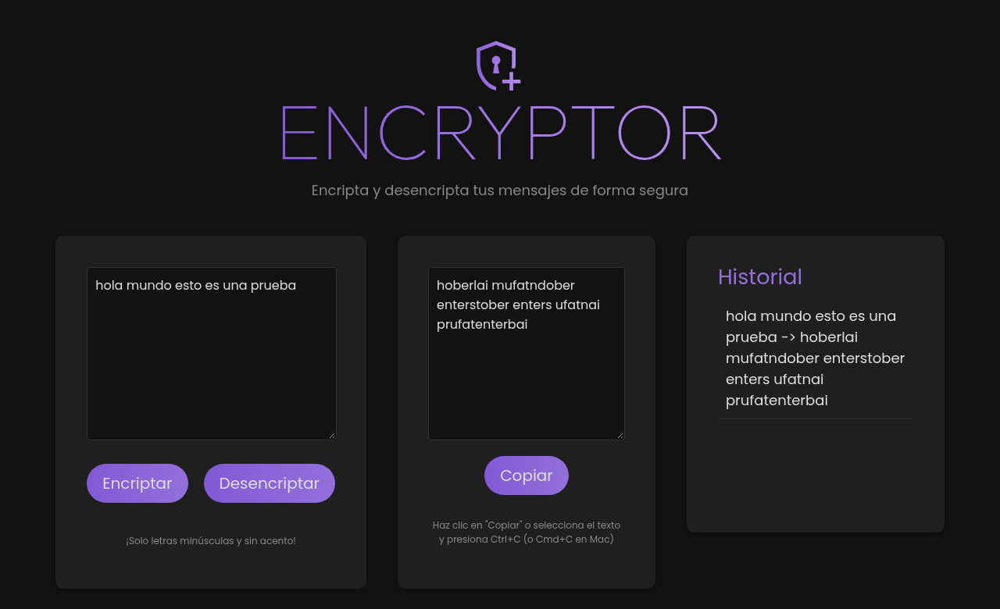

# Encryptor — Encriptador de Texto


Aplicación web que encripta y desencripta mensajes con un cifrado de sustitución de vocales. Sin dependencias ni compilación: HTML, CSS y JavaScript puro.

> Challenge **Encriptador de Texto** del programa Oracle Next Education (Alura Latam), Front-end.



<!-- TODO: enlace a la demo (GitHub Pages: Settings → Pages) -->

## Cómo funciona

Cada vocal se reemplaza por una secuencia fija; las demás letras no cambian:

| Letra | Se encripta como |
|---|---|
| `e` | `enter` |
| `i` | `imes` |
| `a` | `ai` |
| `o` | `ober` |
| `u` | `ufat` |

Ejemplo: `hola` → `hoberlai`.

## Características

- **Encriptar y desencriptar** con las reglas de la tabla.
- **Validación de la entrada:** solo acepta letras minúsculas sin acento y espacios, y avisa cuando hay otros caracteres.
- **Botón "Copiar"** que usa la API del portapapeles y muestra una confirmación animada.
- **Historial** de las operaciones; al hacer clic en una entrada se vuelven a cargar sus textos.
- **Diseño oscuro** y adaptable a pantallas pequeñas.

## Cómo correrlo

No requiere instalación. Abre `index.html` en el navegador o sirve la carpeta con cualquier servidor estático:

```bash
python3 -m http.server 8000
```

Luego visita http://localhost:8000.

## Estructura

```
index.html   -> estructura de la página
style.css    -> estilos
script.js    -> reglas de encriptación, validación, copiado e historial
```

## Autor

**Brayant Vásquez Gómez** · [GitHub](https://github.com/iBrayant) · [LinkedIn](https://linkedin.com/in/brayant-vásquez-gómez)

Licencia [MIT](LICENSE).
